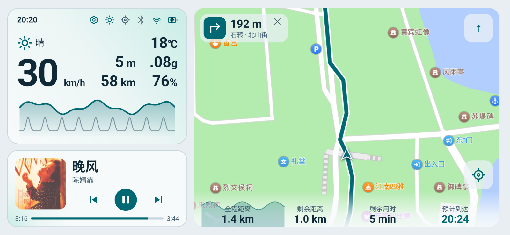
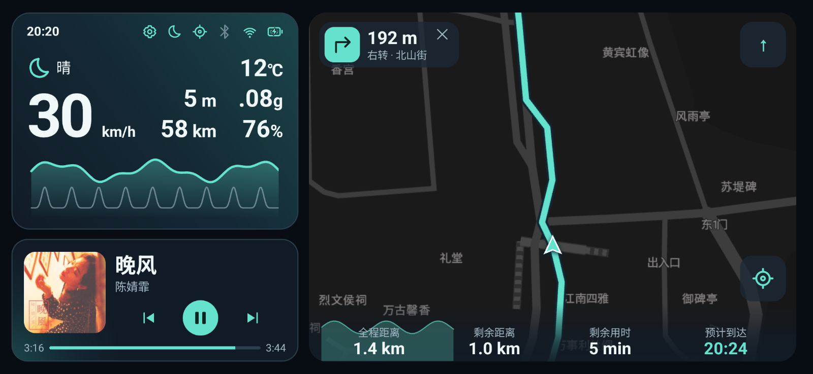
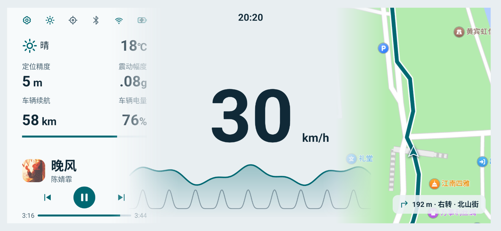
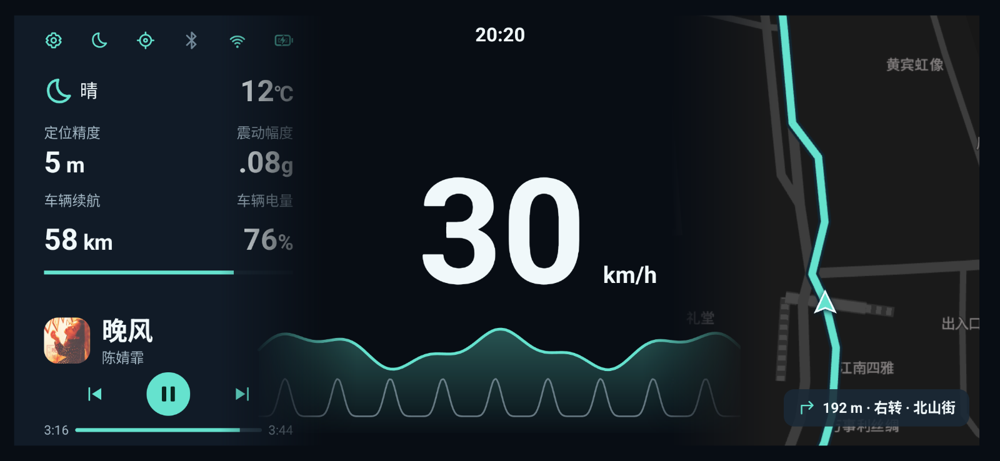
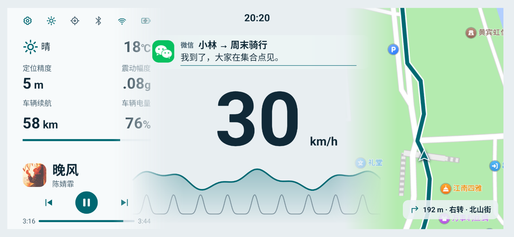
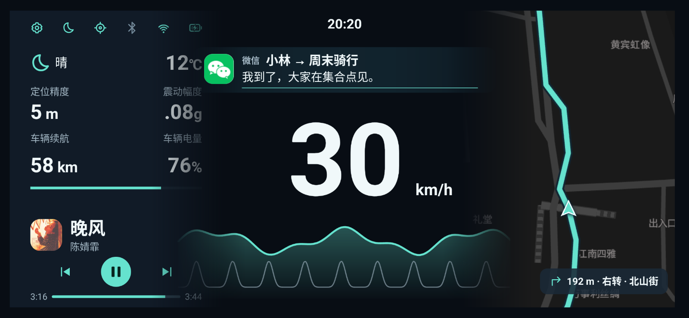
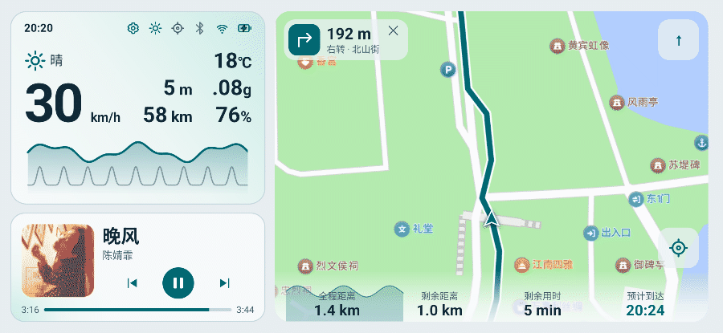
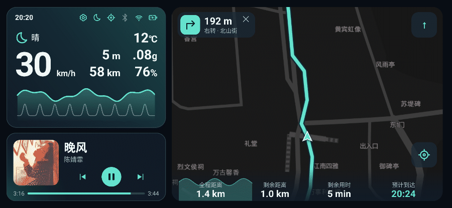

# NinePlay · 九号车机

一部 Android 手机就能当九号电动车的骑行仪表。打开 NinePlay，横屏就能看到当前时速、下一处转向和剩余路程。关联本机的九号出行 App 后，还能对照车辆的预计续航和导航剩余距离。用这部手机听歌时，音乐卡会显示封面和播放进度。收到微信消息，也能在导航画面上看到通知。

当前版本为 **1.0.0**，支持 Android 8.0 及以上。

## 骑行界面

以下为当前版本的模拟器界面示意，天气、速度和车辆读数使用演示数据。

**大地图导航**　左侧顶部显示天气和气温，时速旁显示九号车辆的预计续航和电量，下方曲线记录最近一分钟的速度（青色）和震动（灰色）。右侧地图显示下一处转向，底部可查看全程距离、剩余距离、剩余用时和预计到达时间。

左下角的音乐卡正在播放陈婧霏的《晚风》，封面旁显示歌名和歌手，底部进度条两端分别是已播时间和总时长。





**小地图仪表**　从仪表与地图的分界处向右滑，时速移到中央，曲线沿屏幕底部展开。左侧天气栏下方显示定位精度、震动幅度、车辆续航和电量，电量条位于读数下方。右侧小地图保留转向提示。





**小地图收到微信通知时**，群名、发送人和消息显示在时速上方，左侧音乐卡仍可查看播放进度。





点按小地图或从小地图向左滑即可展开。下图演示一次完整的收起与展开。





## 开始骑行

1. **设置目的地。** 授予精准定位权限后，可以搜索地点、长按地图选点、粘贴高德地点链接，或从高德地图分享地点到 NinePlay，再点「导航」。
2. **查看路线全览。** 导航中点转向提示或底部的全程距离，可查看整条路线。全览时点右上角的 N 或箭头，会按所选方向回到跟随导航。右下角定位按钮可回到当前位置。
3. **查看车辆数据。** 先在同一台 Android 设备的九号出行 App 登录并确认能看到车辆，再打开 NinePlay 的「设置 → 九号APP关联」，按系统提示允许关联小组件。
4. **调整显示。** 顶部的太阳或月亮图标可切换日间和夜间模式。开启系统自动旋转后，可以在两个横屏方向之间切换。

## 本机音乐、通知和按键

| 使用场景 | 操作 |
| --- | --- |
| 播放音乐 | 在手机上用常用的播放器放歌，再点 NinePlay 的音乐区开启「通知使用权」。音乐卡显示歌名、歌手、封面和进度。播放、暂停、切歌和拖动进度取决于播放器支持。 |
| 收到新通知 | 开启「通知使用权」后，本机收到的微信、短信等通知会出现在骑行界面。大地图模式下，通知暂时覆盖音乐卡，向下滑可关闭。小地图模式下，通知显示在时速上方，向上滑可关闭。 |
| 音量键 | 本机播放时单按调音量。双按音量加切到下一曲，双按音量减切到上一曲。 |

## 蓝牙联动（可选）

用备用安卓手机当车机时，通过蓝牙连接兼容的主手机，就能在车机上看到主手机的通知和正在播放的音乐。

## 从源码构建

准备 JDK、Android SDK Platform `android-37.0`、Build Tools `36.0.0` 和 Android 调试签名。复制 `services.local.example.json` 为 `services.local.json`，填入自己的配置：

```json
{
  "amap": {
    "jsKey": "你的高德 JS API Key",
    "jsCode": "你的高德 JS 安全密钥",
    "webKey": "你的高德 Web 服务 Key"
  },
  "qweather": {
    "host": "https://你的专属域名.qweatherapi.com",
    "apiKey": "你的和风天气 API Key"
  }
}
```

天气为可选项：`qweather.host` 填写和风天气控制台分配的 API Host，`qweather.apiKey` 填写 API Key。缺少任意一项时不请求天气、不显示天气栏；原有的 `amap.local.json` 仍可使用。本地配置文件不提交到 Git。

在项目根目录运行以下命令。测试需要 Node.js，安装到设备需要 ADB。

```sh
bash tests/run.sh
./build.sh
adb install -r build/nine-play.apk
```

构建脚本默认使用 macOS 上的 Android Studio JDK、`~/Library/Android/sdk` 和 `~/.android/debug.keystore`。可通过 `JAVA_HOME`、`ANDROID_SDK_ROOT`、`ANDROID_PLATFORM`、`ANDROID_BUILD_TOOLS`、`NINEPLAY_KEYSTORE`、`NINEPLAY_CONFIG` 或 `NINEPLAY_AMAP_CONFIG` 指定其他路径或版本。构建会把服务配置打包进 APK，请为分发版本配置合适的密钥使用限制。

## 骑行诊断

应用在本机记录 JSONL 诊断日志，包含时间、版本、定位、航向校正、导航进度、蓝牙连接和车辆数据更新时间。每个文件最多 4 MiB，总计最多 128 MiB，最多保留 7 天。日志含骑行位置，分享前请检查内容。连接 ADB 后可导出到电脑：

```sh
adb pull /sdcard/Android/data/com.nova5bike.dashboard/files/diagnostics ./nineplay-diagnostics
```
